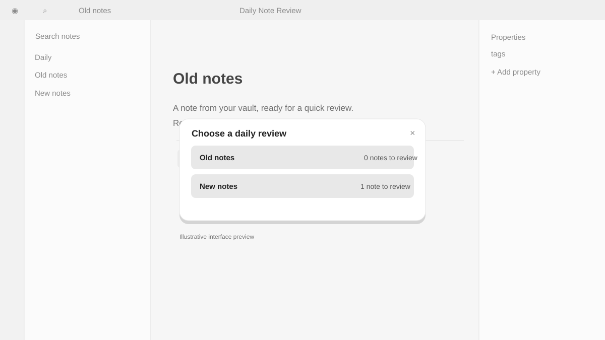
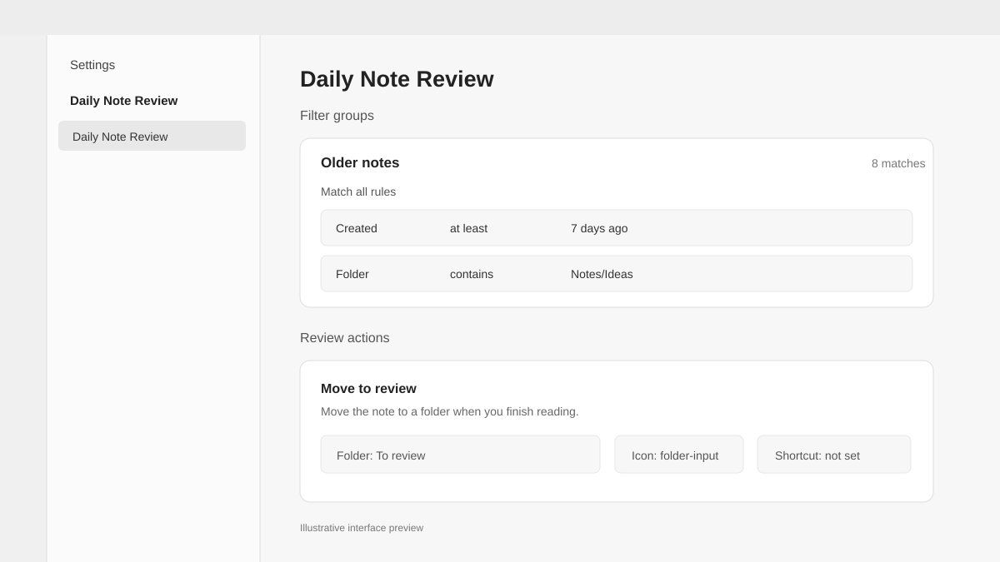

# Daily Note Review

> A simple daily workflow for bringing your notes back to you and reviewing them.

Created by [Windboy](https://github.com/windboy91). Vibe-coded with AI.

I wanted a dedicated system that would bring my notes back to me and make it simple and organized to review them every day. **Daily Note Review** selects notes from your vault using filters you define, then lets you review and sort them from a focused window.

## Demo

### Review your notes

<p align="center"></p>

### Configure filters and actions

<p align="center"></p>

## New in 0.2.0

Three new review actions, available from **Settings → Daily Note Review → Actions** (existing installs get the three buttons added automatically, once):

| Action | What it does |
| --- | --- |
| **Add to daily note** | Pick today, tomorrow, next week (Monday) or any date. If that daily note does not exist, a popup offers to create it, optionally from a template. |
| **Add to a specific note** | Search for a note, or type a name to create a new one. You can also fix the target note in the button settings. |
| **Convert to task** | Status, priority, 📅 due date, ⏳ scheduled date, 🛫 start date, 🔁 recurrence (with "when done"), tags, ➕ creation date and a link to the source note. The task goes to a daily note, a specific note or the note itself. |

Tasks are written with [Tasks plugin](https://publish.obsidian.md/tasks/) emojis by default; you can switch to Dataview inline fields (`[due:: 2026-01-31]`) in the settings. Closing one of these popups without confirming cancels the action, and the note stays in your review queue.

## Interface previews

The static images below are illustrative previews drawn for this README, not screenshots from Obsidian. The animations above are real recordings.

### Choose a daily review



Choose a filter group and see how many notes match before opening the review.

### Filter groups and actions



Build reusable groups of rules and configure the actions available while reviewing.

## What it does

- Selects a daily set of notes, with a configurable daily limit.
- Filters notes by age, folder, tags, and frontmatter properties. Groups combine with **OR**; rules inside a group combine with **AND** or **OR**.
- Shows live match counts and flags common contradictory rules.
- Provides configurable review actions: move or delete a note, change properties, add tags, snooze, open in the background, apply a template, append a link to today's note, **add the note to any daily note or to a specific note**, or **convert it to a task**.
- Supports combined action steps, custom icons and colors, and keyboard shortcuts.
- Remembers notes already reviewed today and notes snoozed for later.
- Can use a frontmatter cover property or the note's first embedded image in the review header.
- Uses French when Obsidian is set to French; otherwise, the interface is in English.

## Install

Download `main.js`, `manifest.json`, and `styles.css` from the [latest release](https://github.com/windboy91/daily-note-review/releases/latest) and place them in `<vault>/.obsidian/plugins/daily-note-review/`. Reload Obsidian, then enable **Daily Note Review** under **Settings → Community plugins**.

With [BRAT](https://github.com/TfTHacker/obsidian42-brat), add the repository `windboy91/daily-note-review` to install and update the plugin automatically.

## Use

Open **Ouvrir la revue quotidienne** / **Open daily review** from the ribbon or command palette. Choose a filter group to start reviewing. Use **Compter les notes à revoir** / **Count notes to review** to see the number of matching notes without opening the review.

The default filter selects notes at least seven days old, with a daily limit of ten. Adjust groups, rules, actions, today's-note location and format, the daily note template, task format and cover behavior in the plugin settings.

## Build from source

1. Run `npm install`.
2. Run `npm run dev` to rebuild when files change, or `npm run build` for a production build. `npm run typecheck` runs the TypeScript checks.
3. Copy `main.js`, `manifest.json`, and `styles.css` into `<vault>/.obsidian/plugins/daily-note-review/`.
4. Reload Obsidian and enable the plugin.

### Releasing

```bash
npm version patch    # or minor / major: updates package.json, manifest.json, versions.json and creates the tag
git push --follow-tags
```

Pushing the tag triggers `.github/workflows/release.yml`, which builds the plugin and publishes `main.js`, `manifest.json` and `styles.css` as release assets. The tag must be exactly the manifest version, without a `v` prefix.

## Status

This is an early release (`0.2.0`). The plugin is being developed and tried in a test vault. Feedback and issue reports are welcome.

See [CHANGELOG.md](CHANGELOG.md) for the version history.

## License

[GPL-3.0](LICENSE)

---

## Français

J’avais besoin d’un système dédié pour que mes notes reviennent à moi et que je puisse les relire simplement, de façon organisée, chaque jour. **Daily Note Review** sélectionne des notes de votre coffre à partir de filtres configurables, puis les présente dans une fenêtre de revue pour les trier au fil de la lecture.

Le plugin peut sélectionner chaque jour un nombre limité de notes, les filtrer par ancienneté, dossier, étiquette ou propriété YAML, et proposer des actions personnalisées : déplacer ou supprimer une note, modifier ses propriétés, ajouter une étiquette, la mettre de côté jusqu'à plus tard, l'ouvrir en arrière-plan, ajouter un lien à la note du jour ou appliquer un modèle. Les groupes de filtres sont combinés par **OU** ; les règles à l'intérieur d'un groupe peuvent être combinées par **ET** ou **OU**. Les résultats et les règles incohérentes sont signalés pendant la configuration.

### Nouveautés de la 0.2.0

Trois nouvelles actions, à ajouter depuis **Paramètres → Daily Note Review → Actions** (les installations existantes reçoivent les trois boutons automatiquement, une seule fois) :

- **Ajouter à la note quotidienne** : aujourd’hui, demain, semaine prochaine (lundi) ou une date de votre choix. Si la note n’existe pas, une fenêtre propose de la créer, éventuellement à partir d’un modèle.
- **Ajouter à une note précise** : recherche d’une note, ou saisie d’un nom pour en créer une nouvelle. La note cible peut aussi être fixée dans les réglages du bouton.
- **Transformer en tâche** : statut, priorité, 📅 échéance, ⏳ date planifiée, 🛫 date de début, 🔁 récurrence (avec « when done »), tags, ➕ date de création et lien vers la note source. La tâche est ajoutée à une note quotidienne, à une note précise ou à la note elle-même. Le format est celui du plugin Tasks (emojis) ou celui de Dataview (champs inline), au choix dans les réglages.

Fermer l’une de ces fenêtres sans valider annule l’action : la note reste dans la file de revue.

L’interface passe automatiquement en français lorsque la langue d’Obsidian est le français. La version actuelle est une première version (`0.2.0`), en cours d’essai dans un coffre de test.

Créé par [Windboy](https://github.com/windboy91), avec Luna 6 comme outil de vibecoding. L’historique des versions : [CHANGELOG.md](CHANGELOG.md).

### Installation

Téléchargez `main.js`, `manifest.json` et `styles.css` depuis la [dernière version publiée](https://github.com/windboy91/daily-note-review/releases/latest), puis placez-les dans `<coffre>/.obsidian/plugins/daily-note-review/`. Rechargez Obsidian et activez **Daily Note Review** dans **Paramètres → Modules complémentaires communautaires**. Avec [BRAT](https://github.com/TfTHacker/obsidian42-brat), ajoutez le dépôt `windboy91/daily-note-review` pour installer et mettre à jour le plugin automatiquement.

### Développement

Lancez `npm install`, puis `npm run dev` pour compiler à chaque modification ou `npm run build` pour une compilation de production (`npm run typecheck` vérifie les types TypeScript). Copiez ensuite `main.js`, `manifest.json` et `styles.css` dans le dossier du plugin de votre coffre et rechargez Obsidian.
