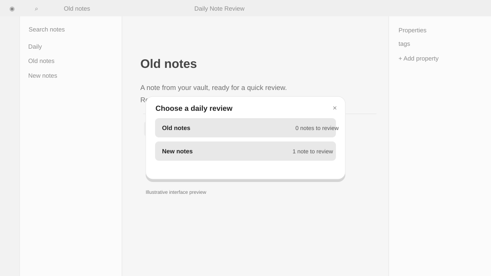
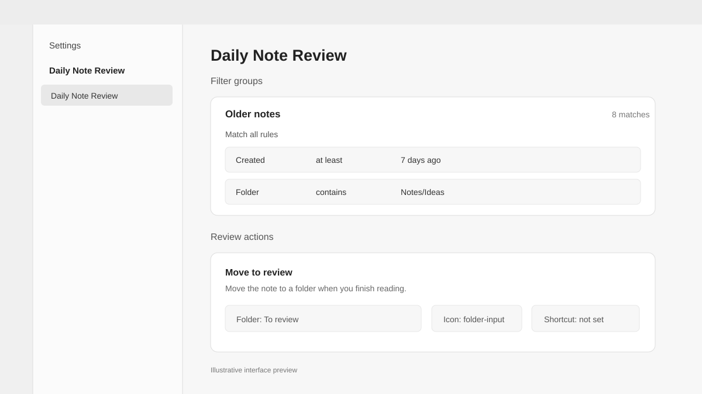

# Daily Note Review

> A simple daily workflow for bringing your notes back to you and reviewing them.

Created by [Windboy](https://github.com/windboy91). Vibe-coded with Luna 6.

I wanted a dedicated system that would bring my notes back to me and make it simple and organized to review them every day. **Daily Note Review** selects notes from your vault using filters you define, then lets you review and sort them from a focused window.

## Interface previews

The images below are illustrative previews of the plugin's interface, not direct screenshots from Obsidian.

### Choose a daily review

Choose a filter group and see how many notes match before opening the review.

### Filter groups and actions

Build reusable groups of rules and configure the actions available while reviewing.

## What it does

- Selects a daily set of notes, with a configurable daily limit.
- Filters notes by age, folder, tags, and frontmatter properties. Groups combine with **OR**; rules inside a group combine with **AND** or **OR**.
- Shows live match counts and flags common contradictory rules.
- Provides configurable review actions: move or delete a note, change properties, add tags, snooze, open in the background, append a link to today's note, or apply a template.
- Supports combined action steps, custom icons and colors, and keyboard shortcuts.
- Remembers notes already reviewed today and notes snoozed for later.
- Can use a frontmatter cover property or the note's first embedded image in the review header.
- Uses French when Obsidian is set to French; otherwise, the interface is in English.

## Install

The plugin is currently available as source code. Once a release is published, download `main.js`, `manifest.json`, and `styles.css` and place them in `<vault>/.obsidian/plugins/daily-note-review/`. Reload Obsidian, then enable **Daily Note Review** under **Settings → Community plugins**.

## Use

Open **Ouvrir la revue quotidienne** / **Open daily review** from the ribbon or command palette. Choose a filter group to start reviewing. Use **Compter les notes à revoir** / **Count notes to review** to see the number of matching notes without opening the review.

The default filter selects notes at least seven days old, with a daily limit of ten. Adjust groups, rules, actions, today's-note location and format, and cover behavior in the plugin settings.

## Build from source

1. Run `npm install`.
2. Run `npm run dev` to rebuild when files change, or `npm run build` for a production build.
3. Copy `main.js`, `manifest.json`, and `styles.css` into `<vault>/.obsidian/plugins/daily-note-review/`.
4. Reload Obsidian and enable the plugin.

## Status

This is an early release (`0.1.0`). The plugin is being developed and tried in a test vault. Feedback and issue reports are welcome.

See [CHANGELOG.md](CHANGELOG.md) for the version history, starting at `0.0.1` and continuing to the current `0.1.0` release.

---

## Français

J’avais besoin d’un système dédié pour que mes notes reviennent à moi et que je puisse les relire simplement, de façon organisée, chaque jour. **Daily Note Review** sélectionne des notes de votre coffre à partir de filtres configurables, puis les présente dans une fenêtre de revue pour les trier au fil de la lecture.

Le plugin peut sélectionner chaque jour un nombre limité de notes, les filtrer par ancienneté, dossier, étiquette ou propriété YAML, et proposer des actions personnalisées : déplacer ou supprimer une note, modifier ses propriétés, ajouter une étiquette, la mettre de côté jusqu'à plus tard, l'ouvrir en arrière-plan, ajouter un lien à la note du jour ou appliquer un modèle. Les groupes de filtres sont combinés par **OU** ; les règles à l'intérieur d'un groupe peuvent être combinées par **ET** ou **OU**. Les résultats et les règles incohérentes sont signalés pendant la configuration.

L’interface passe automatiquement en français lorsque la langue d’Obsidian est le français. La version actuelle est une première version (`0.1.0`), en cours d’essai dans un coffre de test.

Créé par [Windboy](https://github.com/windboy91), avec Luna 6 comme outil de vibecoding. L’historique des versions commence à `0.0.1` et va jusqu’à la version actuelle `0.1.0` : [CHANGELOG.md](CHANGELOG.md).

### Installation manuelle

Après publication d’une version, téléchargez `main.js`, `manifest.json` et `styles.css`, puis placez-les dans `<coffre>/.obsidian/plugins/daily-note-review/`. Rechargez Obsidian et activez **Daily Note Review** dans **Paramètres → Modules complémentaires communautaires**.

### Développement

Lancez `npm install`, puis `npm run dev` pour compiler à chaque modification ou `npm run build` pour une compilation de production. Copiez ensuite `main.js`, `manifest.json` et `styles.css` dans le dossier du plugin de votre coffre et rechargez Obsidian.
