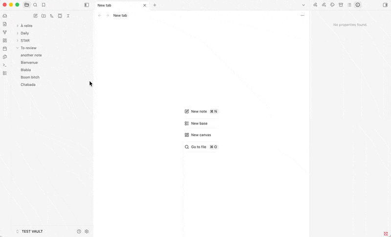
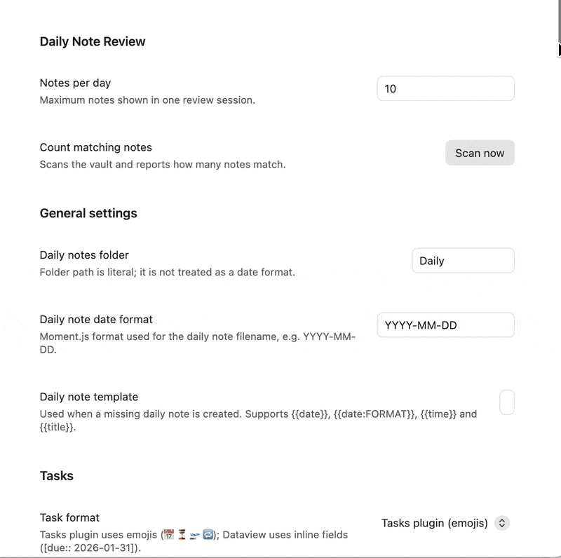

# Daily Note Review

> A simple daily workflow for bringing your notes back to you and reviewing them.

Created by [Windboy](https://github.com/windboy91). Vibe-coded with AI.

I wanted a dedicated system that would bring my notes back to me and make it simple and organized to review them every day. **Daily Note Review** selects notes from your vault using filters you define, then lets you review and sort them from a focused window.

## Demo

### Review your notes

<p align="center"></p>

### Configure filters and actions

<p align="center"></p>

## New in 0.2.0

Three new review actions, available from **Settings → Daily Note Review → Actions** (existing installs get the three buttons added automatically, once):

| Action | What it does |
| --- | --- |
| **Add to daily note** | Pick today, tomorrow, next week (Monday) or any date. If that daily note does not exist, a popup offers to create it, optionally from a template. |
| **Add to a specific note** | Search for a note, or type a name to create a new one. You can also fix the target note in the button settings. |
| **Convert to task** | Status, priority, 📅 due date, ⏳ scheduled date, 🛫 start date, 🔁 recurrence (with "when done"), tags, ➕ creation date and a link to the source note. The task goes to a daily note, a specific note or the note itself. |

Tasks are written with [Tasks plugin](https://publish.obsidian.md/tasks/) emojis by default; you can switch to Dataview inline fields (`[due:: 2026-01-31]`) in the settings. Closing one of these popups without confirming cancels the action, and the note stays in your review queue.

## How it works

1. Setup what notes you want to review based on parameters (Creation date, tags, folders...)
2. Each day (or by clicking the ribbon button or with the commande palette "Daily Note Review: Open daily review"), the plugin prompt you to choose which review you want to do.
3. Based on your selected action, quickly review your notes.

## What it does

- Selects a daily set of notes, with a configurable daily limit.
- Filters notes by age, folder, tags, and frontmatter properties. Groups combine with **OR**; rules inside a group combine with **AND** or **OR**.
- Shows live match counts and flags common contradictory rules.
- Provides configurable review actions: move or delete a note, change properties, add tags, snooze, open in the background, apply a template, append a link to today's note, **add the note to any daily note or to a specific note**, or **convert it to a task**.
- Supports combined action steps, custom icons and colors, and keyboard shortcuts.
- Remembers notes already reviewed today and notes snoozed for later.
- Can use a frontmatter cover property or the note's first embedded image in the review header.
- Uses French when Obsidian is set to French; otherwise, the interface is in English.

## Install

Download `main.js`, `manifest.json`, and `styles.css` from the [latest release](https://github.com/windboy91/daily-note-review/releases/latest) and place them in `<vault>/.obsidian/plugins/daily-note-review/`. Reload Obsidian, then enable **Daily Note Review** under **Settings → Community plugins**.

With [BRAT](https://github.com/TfTHacker/obsidian42-brat), add the repository `windboy91/daily-note-review` to install and update the plugin automatically.

## Use

Open **Open daily review** from the ribbon or command palette. Choose a filter group to start reviewing. Use **Count notes to review** to see the number of matching notes without opening the review.

The default filter selects notes at least seven days old, with a daily limit of ten. Adjust groups, rules, actions, today's-note location and format, the daily note template, task format and cover behavior in the plugin settings.

## Build from source

1. Run `npm install`.
2. Run `npm run dev` to rebuild when files change, or `npm run build` for a production build. `npm run typecheck` runs the TypeScript checks.
3. Copy `main.js`, `manifest.json`, and `styles.css` into `<vault>/.obsidian/plugins/daily-note-review/`.
4. Reload Obsidian and enable the plugin.

### Releasing

```bash
npm version patch    # or minor / major: updates package.json, manifest.json, versions.json and creates the tag
git push --follow-tags
```

Pushing the tag triggers `.github/workflows/release.yml`, which builds the plugin and publishes `main.js`, `manifest.json` and `styles.css` as release assets. The tag must be exactly the manifest version, without a `v` prefix.

## Status

This is an early release (`0.2.0`). The plugin is being developed and tried in a test vault. Feedback and issue reports are welcome.

See [CHANGELOG.md](CHANGELOG.md) for the version history.

## License

[GPL-3.0](LICENSE)
